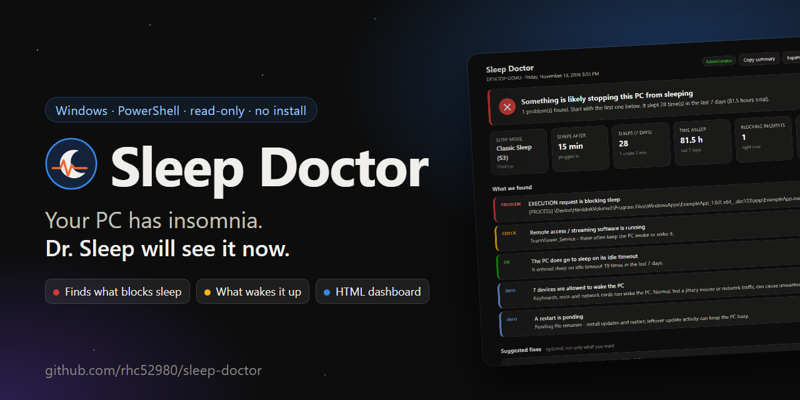
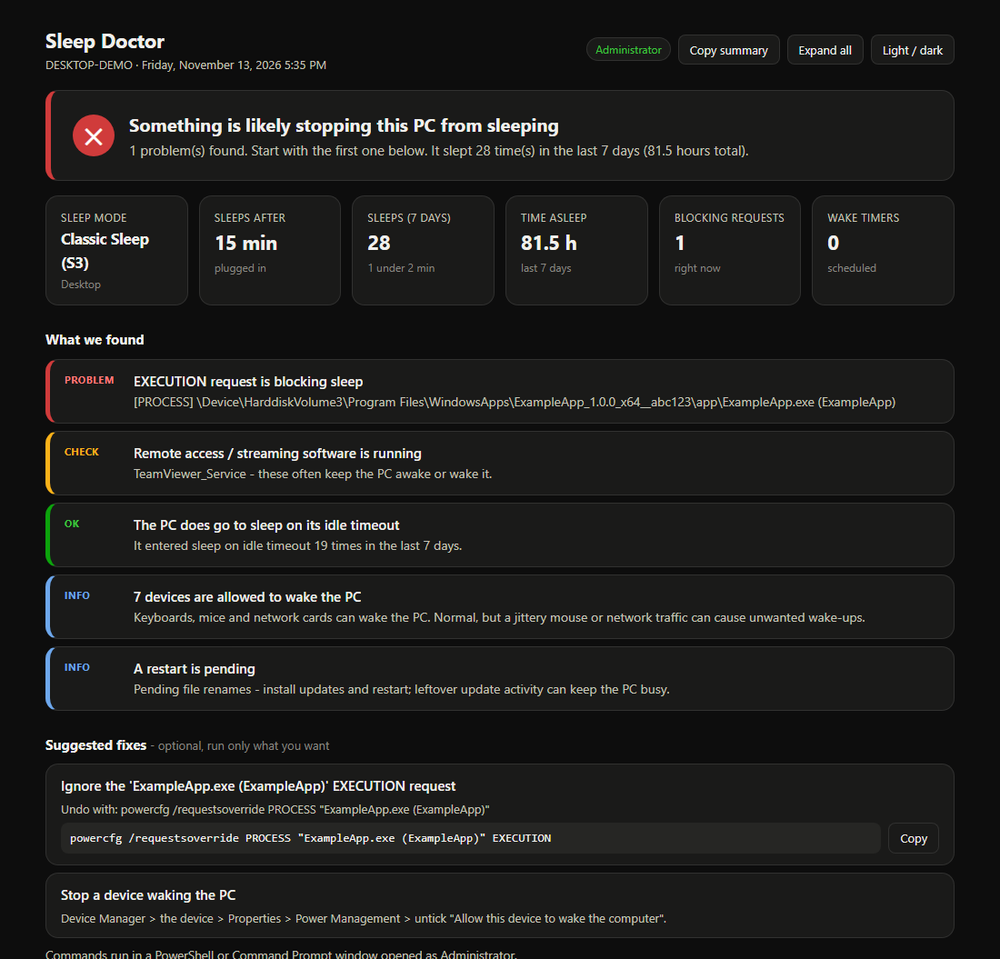
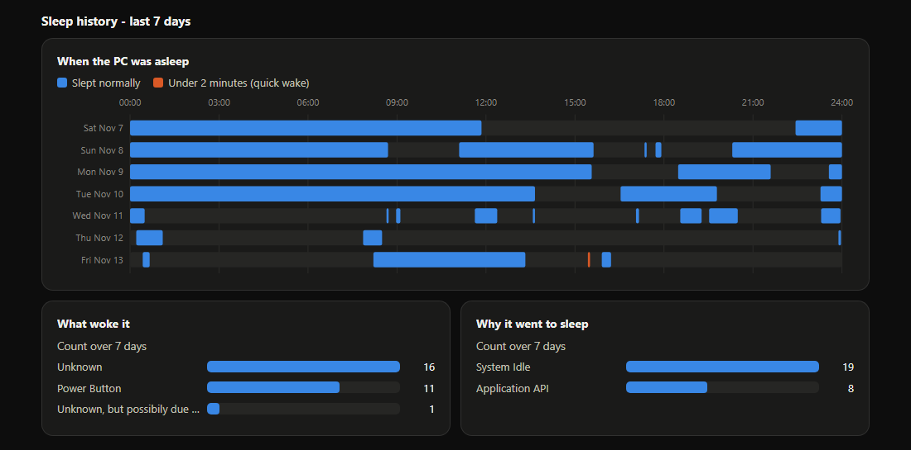
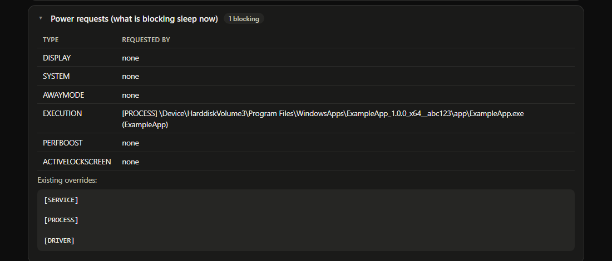
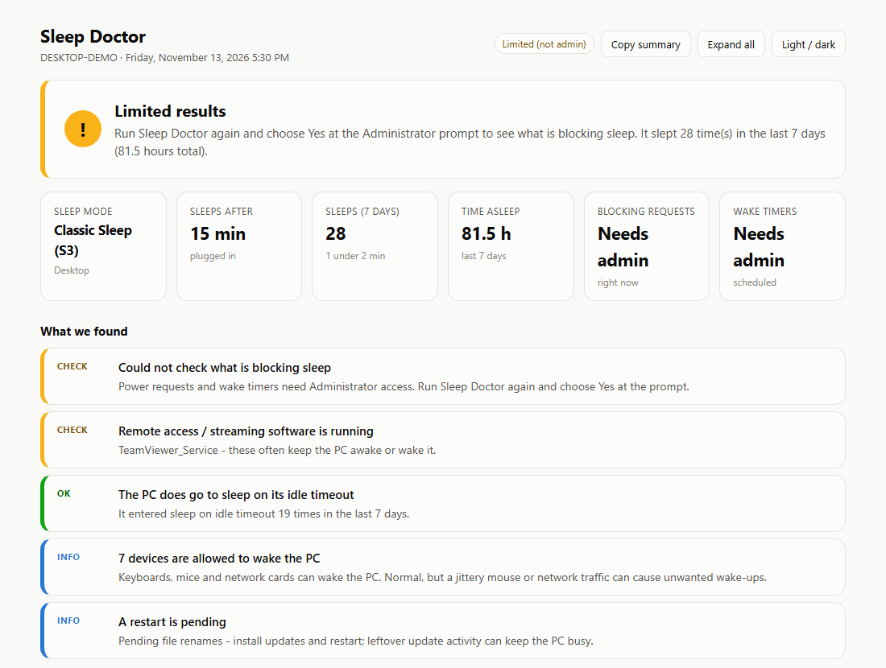

# 🩺 Sleep Doctor

### *Your PC has insomnia. Dr. Sleep will see it now.*

You click **Sleep**. The screen goes black. Ten minutes later the fans are roaring, the RGB is
glowing like a rave in a cave, and your PC is awake, bright-eyed, and refusing to tell you why.

**Sleep Doctor** is a tiny, read-only Windows tool that interrogates your PC like a detective in a
bad crime drama, figures out **what is keeping it awake (or waking it up)**, and shows you the
result in a clean HTML dashboard. No install. No account. Nothing leaves your machine.



---

## ⚡ Quick start (30 seconds)

1. Download **`SleepDoctor.exe`** from the [latest release](../../releases/latest).
2. Double-click it.
3. When it asks **"Run as Administrator?"** say **Yes** (see [why](#-why-it-asks-for-admin)).
4. Your browser opens with the diagnosis. It's also saved on your Desktop.

Prefer plain text you can read before running? Grab the repo and double-click
**`Start-SleepDoctor.cmd`** instead. It runs the exact same [`SleepDoctor.ps1`](SleepDoctor.ps1).

> Windows SmartScreen may say *"Windows protected your PC"* because the `.exe` isn't code-signed
> (certificates cost money; I have snacks to buy). Click **More info → Run anyway**, or just use the
> `.cmd` + `.ps1` pair and read the script first. It's one file and it's all plain PowerShell.

---

## 🧐 What does it actually check?

| Suspect | What Sleep Doctor looks at |
|---|---|
| **The sleep mode itself** | Classic sleep (S3) vs. **Modern Standby** (S0, the "phone-style" sleep that keeps fans and lights alive on some desktops) vs. hibernate only |
| **Apps and drivers holding sleep hostage** | Active power requests (`powercfg /requests`): SYSTEM, DISPLAY, EXECUTION, AWAYMODE, with who asked |
| **Wake timers** | Who is setting an alarm clock for your PC, including the nightly Windows Update and Maintenance wake-ups |
| **Scheduled tasks that wake the PC** | Tasks with *"Wake the computer to run this task"* switched on, and when they next run |
| **Devices allowed to wake it** | Keyboards, mice, controllers, network cards, plus Wake-on-LAN / magic-packet settings per adapter |
| **Your power plan** | Sleep, hibernate, display and unattended timeouts, wake-timer policy, button and lid actions, Group Policy overrides |
| **Remote Desktop and friends** | Active RDP sessions and connections, plus TeamViewer, AnyDesk, Parsec, Sunshine/Moonlight and similar |
| **What's busy right now** | Top CPU users, network connections per process, Windows Update services, pending restarts, usual-suspect apps |
| **7 days of sleep history** | Every sleep and wake from the event log: when it slept, for how long, **why it went to sleep and what woke it up** |
| **Windows' own reports** | With admin: generates the **Sleep Study** and **System Power Report** next to the dashboard (optional `energy` test too) |

---

## 📊 The dashboard

* **A verdict** in plain English: *No sleep problems found*, *Sleep works, but check these*, or *Something is likely stopping this PC from sleeping*.
* **Six at-a-glance numbers**: sleep mode, timeout, sleeps this week, hours asleep, blocking requests, wake timers.
* **Findings** sorted by severity (Problem → Check → OK → Info), each with a one-line explanation. Always a text label, never color alone.
* **Suggested fixes** with a **Copy** button on every command. Nothing runs automatically. You're the doctor's boss.
* **A 7-day timeline** of when the PC was asleep. Quick wake-ups (under 2 minutes) are highlighted in orange, because those are the shady ones.
* **Charts of what woke it and why it went to sleep.**
* **12 collapsible detail sections** for people who want the receipts.
* **Copy summary** button: paste the whole diagnosis into a forum post, a chat, or a help-desk ticket.
* Dark and light mode. Works offline. Fully self-contained single HTML file.



The **Details** sections open up for the receipts. Here, the power-requests table names the exact
process that is holding sleep hostage:



<details>
<summary>Light mode</summary>



</details>

> 📸 *Screenshots are from an Administrator run on a desktop using classic S3 sleep. The computer
> name, user name and the offending app's name are replaced with placeholders (`DESKTOP-DEMO`,
> `ExampleApp`) so no real details are shown.*

---

## 🔑 Why it asks for admin

Windows only shows two of the most useful things to administrators: **what is blocking sleep right
now** (`powercfg /requests`) and **which wake timers are set** (`powercfg /waketimers`), and it
can only build the **Sleep Study** report with admin rights too. If you say *No*, Sleep Doctor still
runs and tells you which parts it couldn't see.

## 🛡️ Is it safe?

* **Read-only.** It never changes a setting, kills a process, or touches your power plan. The only
  things it writes are its own report files (the dashboard and the Windows reports it asks Windows to
  generate) in your Desktop folder, plus a temp copy of the script when you use the `.exe`.
* **Offline.** The script makes **no network calls**. The dashboard loads nothing from the internet.
  Nothing is uploaded anywhere. (Go ahead, `grep` for `http`. I'll wait.)
* **Readable.** It's a single PowerShell script with no dependencies. The `.exe` is a ~60 KB launcher
  that embeds that same script. [`build/Launcher.cs`](build/Launcher.cs) is the whole thing.
* **Suggested fixes are suggestions.** Every one is a command you copy and run yourself, if you want.

---

## 🕵️ Greatest hits: the usual suspects

| Symptom | Likely culprit | Fix idea |
|---|---|---|
| PC wakes at 3 AM | Windows Update's *Schedule Wake To Work* / *Maintenance Activator* wake timer | Disable *Allow wake timers* in the power plan |
| Never sleeps, one app listed in `EXECUTION`/`SYSTEM` requests | Updaters, media players, backup tools, VMs | Close or fix the app, or add a `requestsoverride` |
| Wakes seconds after sleeping | Mouse, keyboard or network card allowed to wake the PC | Untick *Allow this device to wake the computer* |
| Fans and lights stay on while "asleep" | **Modern Standby** on a desktop | Check the Sleep Study; consider hibernate or classic S3 if the firmware supports it |
| Screen never turns off | Display timeout set to *Never*, or a DISPLAY request from a video app | Fix the plan, or close the video app |
| Sleeps fine until you remote in | Remote Desktop / streaming software wakes it or keeps it busy | Sign out of the session instead of just closing the window |
| Sleeps for 0.4 minutes, wakes, repeat | Something pokes the PC every few seconds | The wake-reason chart and Sleep Study will name it |

---

## 🧰 Requirements

* Windows 10 or 11 (uses the Windows PowerShell 5.1 that comes with Windows).
* Works on desktops and laptops, classic sleep or Modern Standby.
* No installs, no admin needed to *run* (admin recommended for full results).

### Command-line options

```powershell
# from the repo folder
powershell -ExecutionPolicy Bypass -File .\SleepDoctor.ps1            # normal run
powershell -ExecutionPolicy Bypass -File .\SleepDoctor.ps1 -Energy    # + 30-second powercfg /energy test
powershell -ExecutionPolicy Bypass -File .\SleepDoctor.ps1 -OutDir D:\Reports -NoOpen
```

`Start-SleepDoctor.cmd energy` does the same as `-Energy`.

## 🔨 Build the `.exe` yourself

No SDKs needed. Windows ships with a C# compiler:

```bat
Build-Exe.cmd
```

It compiles [`build/Launcher.cs`](build/Launcher.cs) with the `csc.exe` already on your PC and embeds
`SleepDoctor.ps1` inside.

## 🤔 Limitations (honest corner)

* Some event text is parsed in **English**. On other Windows languages a few labels (like wake sources) may be blank, though the rest works.
* It can tell you **what** is likely waking or blocking your PC. It can't fix your motherboard's idea of "sleep".
* Desktops on **Modern Standby** may keep fans spinning by design; Sleep Doctor will say so rather than blame a random app.
* Developed and tested on Windows 11. Windows 10 should work but has had less testing.

## 🤝 Contributing

Found a culprit Sleep Doctor missed? Open an issue with the **Copy summary** text from the
dashboard (it contains no personal files, but skim it first) and what finally fixed your PC.
PRs welcome, especially new checks, translations of the event parsing, and bug fixes.

## 📄 License

[MIT](LICENSE). Use it, fork it, put it on a USB stick and become the neighborhood PC hero.

---

*Sleep Doctor is not a licensed medical professional. It cannot treat human insomnia, though it
does recommend you also stop checking your PC at 3 AM.*
